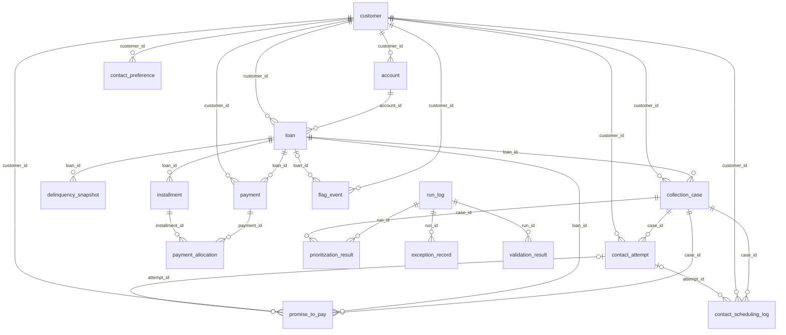

# Data Dictionary

_Generated from `collections_ai/spec.py` by `python scripts/build_docs.py` - the same specification produces `sql/schema.sql`, so this document cannot drift from the database._

Ten mandated entities are marked **[CORE]**. Supporting tables (bridge table, event logs, run outputs) are marked **[SUPPORT]**.
Types: TEXT, INTEGER, REAL, DATE (ISO `YYYY-MM-DD`), DATETIME (ISO `YYYY-MM-DDTHH:MM:SS`, customer-local, no zone), BOOL (0/1), JSON (stored as TEXT).

## Entity relationship diagram

## Relationship and cardinality summary

- **customer**: Customer 1:N Account; Customer 1:N Loan (denormalised, must equal account.customer_id); Customer 1:N ContactPreference (history; one active at a time); Customer 1:N Payment
- **account**: Account N:1 Customer; Account 1:N Loan
- **loan**: Loan N:1 Account; Loan 1:N Installment (exactly tenor_installments); Loan 1:N DelinquencySnapshot; Loan 1:N Payment; Loan 1:N CollectionCase (at most one non-RESOLVED at a time)
- **installment**: Installment N:1 Loan; Installment N:M Payment via payment_allocation
- **delinquency_snapshot**: DelinquencySnapshot N:1 Loan
- **contact_preference**: ContactPreference N:1 Customer (history); exactly one ACTIVE per customer
- **collection_case**: CollectionCase N:1 Loan; CollectionCase N:1 Customer; CollectionCase 1:N ContactAttempt; CollectionCase 1:N PromiseToPay
- **contact_attempt**: ContactAttempt N:1 CollectionCase; ContactAttempt N:1 Customer; ContactAttempt 0..1:N PromiseToPay
- **promise_to_pay**: PromiseToPay N:1 CollectionCase; PromiseToPay N:1 Loan; PromiseToPay N:1 ContactAttempt (optional)
- **payment**: Payment N:1 Loan; Payment N:M Installment via payment_allocation
- **payment_allocation**: PaymentAllocation N:1 Payment; PaymentAllocation N:1 Installment
- **flag_event**: FlagEvent N:1 Customer; FlagEvent N:1 Loan (disputes)
- **contact_scheduling_log**: SchedulingLog N:1 CollectionCase; SchedulingLog 0..1:1 ContactAttempt

Many-to-many relationships use bridge tables: **Payment N:M Installment** via `payment_allocation` (explicit, auditable allocation rows).

## customer [CORE]

Synthetic borrower. No real personal data: names are generated, email uses the reserved .invalid TLD, phone numbers use a clearly fictional pattern.

- **Primary key:** `customer_id`
- **Foreign keys:** none
- **Lifecycle / states:** Static master record.

| Field | Type | Req. | Allowed values / constraint | Unit | Unique | Validation / derivation rule |
|---|---|---|---|---|---|---|
| `customer_id` | TEXT | yes |  |  | yes | Pattern CUS-NNNNNN; immutable |
| `full_name` | TEXT | yes |  |  |  | Synthetic name |
| `date_of_birth` | DATE | yes |  |  |  | Age >= 21 at reference date |
| `email` | TEXT | yes |  |  | yes | Synthetic address @example.invalid |
| `phone` | TEXT | yes |  |  |  | Fictional pattern +000-NNNNNNNNNN |
| `jurisdiction_profile` | TEXT | yes | POLICY_A, POLICY_B, POLICY_C |  |  | Key into config/rules.json jurisdiction_profiles (illustrative, not legal advice) |
| `credit_score` | INTEGER | yes | credit_score BETWEEN 300 AND 900 | points |  |  |
| `risk_category` | TEXT | yes | LOW, MEDIUM, HIGH |  |  | Derived from credit_score: >=700 LOW, 600-699 MEDIUM, <600 HIGH |
| `customer_since` | DATE | yes |  |  |  |  |
| `created_at` | DATETIME | yes |  |  |  | Record creation timestamp (generated data: deterministic business timestamp) |
| `updated_at` | DATETIME | yes |  |  |  | Last update timestamp (>= created_at) |

## account [CORE]

Servicing/billing account owned by a customer. One account can service several loans.

- **Primary key:** `account_id`
- **Foreign keys:** `customer_id` -> `customer.customer_id`
- **Lifecycle / states:** ACTIVE -> SUSPENDED -> ACTIVE, ACTIVE -> CLOSED (terminal).
- **Table constraints:** `closed_date IS NULL OR closed_date >= opened_date`; `((account_status = 'CLOSED') = (closed_date IS NOT NULL))`

| Field | Type | Req. | Allowed values / constraint | Unit | Unique | Validation / derivation rule |
|---|---|---|---|---|---|---|
| `account_id` | TEXT | yes |  |  | yes | Pattern ACC-NNNNNN |
| `customer_id` | TEXT | yes |  |  |  |  |
| `account_type` | TEXT | yes | SALARY_LINKED, SAVINGS_LINKED, CURRENT_LINKED |  |  |  |
| `repayment_method` | TEXT | yes | AUTO_DEBIT, MANUAL_TRANSFER |  |  |  |
| `account_status` | TEXT | yes | ACTIVE, SUSPENDED, CLOSED |  |  | CLOSED requires closed_date; SUSPENDED accounts are excluded from outbound contact |
| `opened_date` | DATE | yes |  |  |  |  |
| `closed_date` | DATE | no |  |  |  | >= opened_date; NOT NULL iff account_status = CLOSED |
| `currency` | TEXT | yes | INR | ISO 4217 |  |  |
| `created_at` | DATETIME | yes |  |  |  | Record creation timestamp (generated data: deterministic business timestamp) |
| `updated_at` | DATETIME | yes |  |  |  | Last update timestamp (>= created_at) |

## loan [CORE]

Instalment loan. Contractual model: flat interest, equal monthly instalments (30-day spacing), last instalment absorbs rounding.

- **Primary key:** `loan_id`
- **Foreign keys:** `account_id` -> `account.account_id`, `customer_id` -> `customer.customer_id`
- **Lifecycle / states:** CURRENT <-> DELINQUENT -> DEFAULT (DPD>90); any -> PAID_OFF (terminal).
- **Table constraints:** `((loan_status = 'PAID_OFF') = (payoff_date IS NOT NULL))`; `maturity_date >= first_due_date`; `first_due_date > origination_date`

| Field | Type | Req. | Allowed values / constraint | Unit | Unique | Validation / derivation rule |
|---|---|---|---|---|---|---|
| `loan_id` | TEXT | yes |  |  | yes | Pattern LOAN-2026-NNNNNN |
| `account_id` | TEXT | yes |  |  |  |  |
| `customer_id` | TEXT | yes |  |  |  | Must equal account.customer_id |
| `product_type` | TEXT | yes | PERSONAL_LOAN, CONSUMER_DURABLE, SMALL_BUSINESS, EDUCATION |  |  |  |
| `principal_amount` | REAL | yes | principal_amount > 0 | INR |  |  |
| `interest_rate_pct` | REAL | yes | interest_rate_pct >= 0 | % p.a. |  |  |
| `tenor_installments` | INTEGER | yes | tenor_installments >= 1 | count |  |  |
| `total_payable` | REAL | yes |  | INR |  | = SUM(installment.amount_due) (arithmetic check) |
| `origination_date` | DATE | yes |  |  |  |  |
| `first_due_date` | DATE | yes |  |  |  | = origination_date + 30 days |
| `maturity_date` | DATE | yes |  |  |  | = due date of last instalment |
| `loan_status` | TEXT | yes | CURRENT, DELINQUENT, DEFAULT, PAID_OFF |  |  | DERIVED as of status_as_of from instalments+allocations (see BUSINESS_RULES) |
| `status_as_of` | DATE | yes |  |  |  | Business reference date used to derive loan_status |
| `payoff_date` | DATE | no |  |  |  | Date of final allocation; NOT NULL iff loan_status = PAID_OFF |
| `created_at` | DATETIME | yes |  |  |  | Record creation timestamp (generated data: deterministic business timestamp) |
| `updated_at` | DATETIME | yes |  |  |  | Last update timestamp (>= created_at) |

## installment [CORE]

Scheduled repayment. amount_paid / status / fully_paid_date are derived from payment_allocation.

- **Primary key:** `installment_id`
- **Foreign keys:** `loan_id` -> `loan.loan_id`
- **Composite uniqueness:** (loan_id, installment_number)
- **Lifecycle / states:** NOT_DUE -> OVERDUE -> PARTIALLY_PAID -> PAID (or NOT_DUE -> PAID).
- **Table constraints:** `amount_paid >= 0 AND amount_paid <= amount_due + 0.005`; `((installment_status = 'PAID') = (fully_paid_date IS NOT NULL))`

| Field | Type | Req. | Allowed values / constraint | Unit | Unique | Validation / derivation rule |
|---|---|---|---|---|---|---|
| `installment_id` | TEXT | yes |  |  | yes | Pattern INS-<loan_id>-NNN |
| `loan_id` | TEXT | yes |  |  |  |  |
| `installment_number` | INTEGER | yes | installment_number >= 1 |  |  |  |
| `due_date` | DATE | yes |  |  |  |  |
| `amount_due` | REAL | yes | amount_due > 0 | INR |  |  |
| `principal_component` | REAL | yes | principal_component >= 0 | INR |  |  |
| `interest_component` | REAL | yes | interest_component >= 0 | INR |  |  |
| `amount_paid` | REAL | yes |  | INR |  | DERIVED: SUM(allocated_amount); 0 <= amount_paid <= amount_due |
| `installment_status` | TEXT | yes | NOT_DUE, PAID, PARTIALLY_PAID, OVERDUE |  |  | PAID if remaining=0; NOT_DUE if due_date>=as-of; OVERDUE if due<as-of and nothing paid; else PARTIALLY_PAID |
| `fully_paid_date` | DATE | no |  |  |  | Date of allocation that cleared the instalment; NOT NULL iff PAID |
| `created_at` | DATETIME | yes |  |  |  | Record creation timestamp (generated data: deterministic business timestamp) |
| `updated_at` | DATETIME | yes |  |  |  | Last update timestamp (>= created_at) |

## delinquency_snapshot [CORE]

Immutable point-in-time delinquency measurement for a loan (month-end snapshots + reference date).

- **Primary key:** `snapshot_id`
- **Foreign keys:** `loan_id` -> `loan.loan_id`
- **Composite uniqueness:** (loan_id, snapshot_date)
- **Lifecycle / states:** Append-only; never updated.
- **Table constraints:** `total_arrears >= 0`; `outstanding_balance >= -0.005`; `days_past_due >= 0`

| Field | Type | Req. | Allowed values / constraint | Unit | Unique | Validation / derivation rule |
|---|---|---|---|---|---|---|
| `snapshot_id` | TEXT | yes |  |  | yes | Pattern SNP-2026-NNNNNN |
| `loan_id` | TEXT | yes |  |  |  |  |
| `snapshot_date` | DATE | yes |  |  |  |  |
| `total_amount_paid` | REAL | yes |  | INR |  | SUM of allocations dated <= snapshot_date |
| `outstanding_balance` | REAL | yes |  | INR |  | total_payable - total_amount_paid (contractual balance) |
| `total_arrears` | REAL | yes |  | INR |  | SUM(amount_due - allocated as of date) over instalments with due_date < snapshot_date |
| `overdue_installments` | INTEGER | yes |  | count |  |  |
| `days_past_due` | INTEGER | yes |  | days |  | snapshot_date - due_date of the oldest unpaid overdue instalment; 0 if none |
| `delinquency_bucket` | TEXT | yes | PAID_OFF, CURRENT, DPD_1_30, DPD_31_60, DPD_61_90, DPD_90_PLUS |  |  |  |
| `loan_status` | TEXT | yes | CURRENT, DELINQUENT, DEFAULT, PAID_OFF |  |  |  |
| `created_at` | DATETIME | yes |  |  |  | Record creation timestamp (generated data: deterministic business timestamp) |
| `updated_at` | DATETIME | yes |  |  |  | Last update timestamp (>= created_at) |

## contact_preference [CORE]

Customer communication preferences with effective dating (history retained; one active row per customer at a time).

- **Primary key:** `preference_id`
- **Foreign keys:** `customer_id` -> `customer.customer_id`
- **Lifecycle / states:** ACTIVE -> SUPERSEDED (a new row is inserted; old rows are never overwritten).
- **Table constraints:** `effective_to IS NULL OR effective_to >= effective_from`; `((status = 'ACTIVE') = (effective_to IS NULL))`; `window_end > window_start`

| Field | Type | Req. | Allowed values / constraint | Unit | Unique | Validation / derivation rule |
|---|---|---|---|---|---|---|
| `preference_id` | TEXT | yes |  |  | yes | Pattern CPF-2026-NNNNNN |
| `customer_id` | TEXT | yes |  |  |  |  |
| `preferred_channel` | TEXT | yes | PHONE, SMS, EMAIL, POST |  |  |  |
| `allow_phone` | BOOL | yes |  |  |  |  |
| `allow_sms` | BOOL | yes |  |  |  |  |
| `allow_email` | BOOL | yes |  |  |  |  |
| `allow_post` | BOOL | yes |  |  |  |  |
| `allowed_days` | TEXT | yes |  |  |  | Comma list of MON..SUN; may be empty only if opt_out_all |
| `window_start` | TEXT | yes |  | HH:MM local time |  |  |
| `window_end` | TEXT | yes |  | HH:MM local time |  | > window_start |
| `max_contacts_per_week` | INTEGER | no |  | count |  | Optional stricter customer limit |
| `opt_out_all` | BOOL | yes |  |  |  | 1 = customer opted out of ALL outbound collection contact |
| `consent_source` | TEXT | yes | ENROLMENT, CUSTOMER_REQUEST, BRANCH |  |  |  |
| `effective_from` | DATE | yes |  |  |  |  |
| `effective_to` | DATE | no |  |  |  | NULL while current; >= effective_from |
| `status` | TEXT | yes | ACTIVE, SUPERSEDED |  |  | ACTIVE iff effective_to IS NULL |
| `created_at` | DATETIME | yes |  |  |  | Record creation timestamp (generated data: deterministic business timestamp) |
| `updated_at` | DATETIME | yes |  |  |  | Last update timestamp (>= created_at) |

## collection_case [CORE]

Collection workflow case opened when a loan reaches the case-opening DPD threshold.

- **Primary key:** `case_id`
- **Foreign keys:** `loan_id` -> `loan.loan_id`, `customer_id` -> `customer.customer_id`
- **Lifecycle / states:** OPEN <-> PROMISE_PENDING / DISPUTE_REVIEW / HARDSHIP_REVIEW -> RESOLVED (terminal). History in audit_event.
- **Table constraints:** `closed_date IS NULL OR closed_date >= opened_date`; `((case_status = 'RESOLVED') = (closed_date IS NOT NULL))`

| Field | Type | Req. | Allowed values / constraint | Unit | Unique | Validation / derivation rule |
|---|---|---|---|---|---|---|
| `case_id` | TEXT | yes |  |  | yes | Pattern COL-2026-NNNNNN |
| `loan_id` | TEXT | yes |  |  |  |  |
| `customer_id` | TEXT | yes |  |  |  |  |
| `opened_date` | DATE | yes |  |  |  |  |
| `closed_date` | DATE | no |  |  |  | NOT NULL iff case_status = RESOLVED |
| `case_status` | TEXT | yes | OPEN, PROMISE_PENDING, DISPUTE_REVIEW, HARDSHIP_REVIEW, RESOLVED |  |  | Precedence: RESOLVED > DISPUTE_REVIEW > HARDSHIP_REVIEW > PROMISE_PENDING > OPEN |
| `debt_confirmation_status` | TEXT | yes | UNVERIFIED, DISPUTED, CONFIRMED |  |  | DISPUTED while a dispute flag is active; CONFIRMED after a dispute cleared as DEBT_VALIDATED; else UNVERIFIED |
| `opening_dpd` | INTEGER | yes |  | days |  | Days past due when case opened (derived) |
| `opening_arrears` | REAL | yes |  | INR |  | Arrears when case opened (derived) |
| `assigned_analyst` | TEXT | yes |  |  |  | Synthetic analyst code |
| `created_at` | DATETIME | yes |  |  |  | Record creation timestamp (generated data: deterministic business timestamp) |
| `updated_at` | DATETIME | yes |  |  |  | Last update timestamp (>= created_at) |

## contact_attempt [CORE]

A contact task (scheduled or completed) against a case. Only created after the eligibility engine PERMITS the request.

- **Primary key:** `attempt_id`
- **Foreign keys:** `case_id` -> `collection_case.case_id`, `customer_id` -> `customer.customer_id`
- **Composite uniqueness:** (case_id, sequence_number)
- **Lifecycle / states:** SCHEDULED -> COMPLETED | CANCELLED.
- **Table constraints:** `((attempt_status = 'COMPLETED') = (outcome IS NOT NULL))`

| Field | Type | Req. | Allowed values / constraint | Unit | Unique | Validation / derivation rule |
|---|---|---|---|---|---|---|
| `attempt_id` | TEXT | yes |  |  | yes | Pattern CTP-<case_id>-NNN |
| `case_id` | TEXT | yes |  |  |  |  |
| `customer_id` | TEXT | yes |  |  |  |  |
| `sequence_number` | INTEGER | yes |  |  |  | 1-based per case; matches suffix of attempt_id |
| `channel` | TEXT | yes | PHONE, SMS, EMAIL, POST |  |  |  |
| `purpose` | TEXT | yes | COLLECTION_REMINDER, PROMISE_FOLLOWUP, DISPUTE_RESPONSE, HARDSHIP_REVIEW_OUTREACH |  |  |  |
| `scheduled_for` | DATETIME | yes |  |  |  | Local customer time, ISO-8601 without zone |
| `attempt_status` | TEXT | yes | SCHEDULED, COMPLETED, CANCELLED |  |  |  |
| `outcome` | TEXT | no | NO_ANSWER, MESSAGE_SENT, BOUNCED, REACHED_NO_COMMITMENT, REACHED_PROMISE_MADE, REACHED_DISPUTE_RAISED, REACHED_HARDSHIP_DECLARED |  |  | NOT NULL iff attempt_status = COMPLETED |
| `created_at` | DATETIME | yes |  |  |  | Record creation timestamp (generated data: deterministic business timestamp) |
| `updated_at` | DATETIME | yes |  |  |  | Last update timestamp (>= created_at) |

## promise_to_pay [CORE]

Customer commitment to pay an amount by a date. Status is derived from subsequent payment allocations.

- **Primary key:** `promise_id`
- **Foreign keys:** `case_id` -> `collection_case.case_id`, `loan_id` -> `loan.loan_id`, `customer_id` -> `customer.customer_id`, `attempt_id` -> `contact_attempt.attempt_id` (optional)
- **Lifecycle / states:** PENDING -> FULFILLED | PARTIALLY_FULFILLED | BROKEN (outcome transitions logged in audit_event).
- **Table constraints:** `promised_date >= created_date`; `amount_received >= 0`; `((promise_status = 'PENDING') = (evaluated_on IS NULL))`

| Field | Type | Req. | Allowed values / constraint | Unit | Unique | Validation / derivation rule |
|---|---|---|---|---|---|---|
| `promise_id` | TEXT | yes |  |  | yes | Pattern PTP-2026-NNNNNN |
| `case_id` | TEXT | yes |  |  |  |  |
| `loan_id` | TEXT | yes |  |  |  |  |
| `customer_id` | TEXT | yes |  |  |  |  |
| `attempt_id` | TEXT | no |  |  |  | NULL for inbound/unlinked promises |
| `created_date` | DATE | yes |  |  |  |  |
| `promised_amount` | REAL | yes | promised_amount > 0 | INR |  |  |
| `promised_date` | DATE | yes |  |  |  | >= created_date |
| `arrears_at_creation` | REAL | yes |  | INR |  | Arrears as of created_date recomputed from source and compared by validation |
| `promise_status` | TEXT | yes | PENDING, FULFILLED, PARTIALLY_FULFILLED, BROKEN |  |  |  |
| `amount_received` | REAL | yes |  | INR |  | DERIVED: allocations dated in [created_date, promised_date + grace] |
| `evaluated_on` | DATE | no |  |  |  | Date the final outcome was determined; NULL while PENDING |
| `exception_approved_by` | TEXT | no |  |  |  | Required when promised_amount > arrears_at_creation (documented exception workflow) |
| `exception_reason` | TEXT | no |  |  |  |  |
| `created_at` | DATETIME | yes |  |  |  | Record creation timestamp (generated data: deterministic business timestamp) |
| `updated_at` | DATETIME | yes |  |  |  | Last update timestamp (>= created_at) |

## payment [CORE]

Money received on a loan. Allocation to instalments is recorded explicitly in payment_allocation.

- **Primary key:** `payment_id`
- **Foreign keys:** `loan_id` -> `loan.loan_id`, `customer_id` -> `customer.customer_id`
- **Lifecycle / states:** Immutable once posted; reconciliation_status transitions are audited.

| Field | Type | Req. | Allowed values / constraint | Unit | Unique | Validation / derivation rule |
|---|---|---|---|---|---|---|
| `payment_id` | TEXT | yes |  |  | yes | Pattern PMT-2026-NNNNNN |
| `loan_id` | TEXT | yes |  |  |  |  |
| `customer_id` | TEXT | yes |  |  |  |  |
| `payment_date` | DATE | yes |  |  |  |  |
| `amount` | REAL | yes | amount > 0 | INR |  |  |
| `channel` | TEXT | yes | BANK_TRANSFER, UPI, CARD, CASH_DEPOSIT, AUTO_DEBIT |  |  |  |
| `reference` | TEXT | yes |  |  | yes | Synthetic bank reference; unique (duplicate detection) |
| `reconciliation_status` | TEXT | yes | UNRECONCILED, RECONCILED, EXCEPTION |  |  | RECONCILED = fully allocated and consistent with FIFO policy; EXCEPTION otherwise |
| `created_at` | DATETIME | yes |  |  |  | Record creation timestamp (generated data: deterministic business timestamp) |
| `updated_at` | DATETIME | yes |  |  |  | Last update timestamp (>= created_at) |

## payment_allocation [SUPPORT]

Bridge table (Payment N:M Installment): explicit, auditable allocation of payment amounts.

- **Primary key:** `allocation_id`
- **Foreign keys:** `payment_id` -> `payment.payment_id`, `installment_id` -> `installment.installment_id`
- **Composite uniqueness:** (payment_id, installment_id)
- **Lifecycle / states:** Append-only.

| Field | Type | Req. | Allowed values / constraint | Unit | Unique | Validation / derivation rule |
|---|---|---|---|---|---|---|
| `allocation_id` | TEXT | yes |  |  | yes | Pattern ALC-2026-NNNNNN |
| `payment_id` | TEXT | yes |  |  |  |  |
| `installment_id` | TEXT | yes |  |  |  |  |
| `allocated_amount` | REAL | yes | allocated_amount > 0 | INR |  |  |
| `allocation_date` | DATE | yes |  |  |  | Equals payment.payment_date |
| `allocation_rule` | TEXT | yes | FIFO_OLDEST_DUE_FIRST |  |  | Policy applied: oldest due first |
| `created_at` | DATETIME | yes |  |  |  | Record creation timestamp (generated data: deterministic business timestamp) |
| `updated_at` | DATETIME | yes |  |  |  | Last update timestamp (>= created_at) |

## flag_event [SUPPORT]

Event history of hardship and dispute flags (raised/cleared). Current state = latest event at or before the as-of time.

- **Primary key:** `flag_event_id`
- **Foreign keys:** `customer_id` -> `customer.customer_id`, `loan_id` -> `loan.loan_id` (optional)
- **Lifecycle / states:** Append-only event log.
- **Table constraints:** `(flag_type <> 'DISPUTE' OR loan_id IS NOT NULL)`; `(resolution_outcome IS NULL OR (flag_type = 'DISPUTE' AND event_type = 'CLEARED'))`

| Field | Type | Req. | Allowed values / constraint | Unit | Unique | Validation / derivation rule |
|---|---|---|---|---|---|---|
| `flag_event_id` | TEXT | yes |  |  | yes | Pattern FLG-2026-NNNNNN |
| `customer_id` | TEXT | yes |  |  |  |  |
| `loan_id` | TEXT | no |  |  |  | Required for DISPUTE (loan-level); NULL for HARDSHIP (customer-level) |
| `flag_type` | TEXT | yes | HARDSHIP, DISPUTE |  |  |  |
| `event_type` | TEXT | yes | RAISED, CLEARED |  |  |  |
| `event_at` | DATETIME | yes |  |  |  |  |
| `source` | TEXT | yes | CUSTOMER_CONTACT, ANALYST, SYSTEM |  |  |  |
| `resolution_outcome` | TEXT | no | DEBT_VALIDATED |  |  | Only on CLEARED DISPUTE |
| `note` | TEXT | no |  |  |  |  |
| `created_at` | DATETIME | yes |  |  |  | Record creation timestamp (generated data: deterministic business timestamp) |
| `updated_at` | DATETIME | yes |  |  |  | Last update timestamp (>= created_at) |

## contact_scheduling_log [SUPPORT]

Every contact scheduling request with the eligibility decision and reason codes (permitted and rejected).

- **Primary key:** `log_id`
- **Foreign keys:** `case_id` -> `collection_case.case_id`, `customer_id` -> `customer.customer_id`, `attempt_id` -> `contact_attempt.attempt_id` (optional)
- **Lifecycle / states:** Append-only.
- **Table constraints:** `((decision = 'PERMITTED') = (attempt_id IS NOT NULL))`

| Field | Type | Req. | Allowed values / constraint | Unit | Unique | Validation / derivation rule |
|---|---|---|---|---|---|---|
| `log_id` | TEXT | yes |  |  | yes | Pattern SCH-2026-NNNNNN |
| `case_id` | TEXT | yes |  |  |  |  |
| `customer_id` | TEXT | yes |  |  |  |  |
| `requested_channel` | TEXT | yes | PHONE, SMS, EMAIL, POST |  |  |  |
| `requested_for` | DATETIME | yes |  |  |  |  |
| `purpose` | TEXT | yes | COLLECTION_REMINDER, PROMISE_FOLLOWUP, DISPUTE_RESPONSE, HARDSHIP_REVIEW_OUTREACH |  |  |  |
| `decision` | TEXT | yes | PERMITTED, REJECTED |  |  |  |
| `reason_codes` | TEXT | yes |  |  |  | Comma list of reason codes; ALL_RULES_PASSED when permitted |
| `attempt_id` | TEXT | no |  |  |  | Set when PERMITTED |
| `requested_by` | TEXT | yes |  |  |  |  |
| `decided_at` | DATETIME | yes |  |  |  |  |
| `rules_version` | TEXT | yes |  |  |  |  |
| `created_at` | DATETIME | yes |  |  |  | Record creation timestamp (generated data: deterministic business timestamp) |
| `updated_at` | DATETIME | yes |  |  |  | Last update timestamp (>= created_at) |

## audit_event [SUPPORT]

Append-only audit trail of important state transitions.

- **Primary key:** `audit_id`
- **Foreign keys:** none
- **Lifecycle / states:** Append-only.

| Field | Type | Req. | Allowed values / constraint | Unit | Unique | Validation / derivation rule |
|---|---|---|---|---|---|---|
| `audit_id` | TEXT | yes |  |  | yes | Pattern AUD-2026-NNNNNN |
| `entity_type` | TEXT | yes | CASE, PROMISE, PAYMENT, CONTACT_ATTEMPT, EXCEPTION, RUN, FLAG, LOAN |  |  |  |
| `entity_id` | TEXT | yes |  |  |  |  |
| `action` | TEXT | yes |  |  |  |  |
| `old_value` | TEXT | no |  |  |  |  |
| `new_value` | TEXT | no |  |  |  |  |
| `actor` | TEXT | yes |  |  |  | SYSTEM, GENERATOR, or an analyst/API identity |
| `reason` | TEXT | no |  |  |  |  |
| `event_ts` | DATETIME | yes |  |  |  |  |
| `details` | JSON | no |  |  |  |  |

## run_log [SUPPORT]

Execution log of prioritization / exception-detection / validation / reconciliation runs.

- **Primary key:** `run_id`
- **Foreign keys:** none

| Field | Type | Req. | Allowed values / constraint | Unit | Unique | Validation / derivation rule |
|---|---|---|---|---|---|---|
| `run_id` | TEXT | yes |  |  | yes |  |
| `run_type` | TEXT | yes | PRIORITIZATION, EXCEPTION_DETECTION, VALIDATION, RECONCILIATION, DATA_LOAD |  |  |  |
| `as_of_date` | DATE | yes |  |  |  |  |
| `started_at` | DATETIME | yes |  |  |  | Operational wall-clock time (intentionally non-deterministic for API runs) |
| `rules_version` | TEXT | no |  |  |  |  |
| `summary` | JSON | no |  |  |  |  |

## prioritization_result [SUPPORT]

Persisted, explainable prioritization output for a case in a run.

- **Primary key:** `result_id`
- **Foreign keys:** `run_id` -> `run_log.run_id`, `case_id` -> `collection_case.case_id`
- **Composite uniqueness:** (run_id, case_id)

| Field | Type | Req. | Allowed values / constraint | Unit | Unique | Validation / derivation rule |
|---|---|---|---|---|---|---|
| `result_id` | TEXT | yes |  |  | yes |  |
| `run_id` | TEXT | yes |  |  |  |  |
| `case_id` | TEXT | yes |  |  |  |  |
| `as_of_date` | DATE | yes |  |  |  |  |
| `priority_score` | REAL | yes | priority_score BETWEEN 0 AND 100 | 0-100 |  |  |
| `priority_category` | TEXT | yes | P1_HIGH, P2_MEDIUM, P3_LOW, HARDSHIP_REVIEW, MONITOR_PROMISE, SUPPRESSED |  |  |  |
| `contributing_factors` | JSON | yes |  |  |  | List of {factor, value, points, explanation} |
| `reason_codes` | TEXT | yes |  |  |  |  |
| `suppression_reasons` | TEXT | no |  |  |  |  |
| `recommended_action` | TEXT | yes |  |  |  |  |
| `recommended_channel` | TEXT | no | PHONE, SMS, EMAIL, POST |  |  |  |
| `recommended_slot` | DATETIME | no |  |  |  |  |
| `explanation` | TEXT | yes |  |  |  |  |

## exception_record [SUPPORT]

Compliance/data exception detected from source data (never from ground truth).

- **Primary key:** `exception_id`
- **Foreign keys:** `run_id` -> `run_log.run_id`

| Field | Type | Req. | Allowed values / constraint | Unit | Unique | Validation / derivation rule |
|---|---|---|---|---|---|---|
| `exception_id` | TEXT | yes |  |  | yes |  |
| `run_id` | TEXT | yes |  |  |  |  |
| `exception_type` | TEXT | yes | PAID_ACCOUNT_IN_COLLECTION, CONTACT_OUTSIDE_ALLOWED_WINDOW, PAYMENT_ALLOCATED_TO_WRONG_INSTALLMENT, PROMISE_AMOUNT_EXCEEDS_ARREARS, DISPUTED_DEBT_TREATED_AS_CONFIRMED |  |  |  |
| `severity` | TEXT | yes | LOW, MEDIUM, HIGH, CRITICAL |  |  |  |
| `entity_type` | TEXT | yes |  |  |  |  |
| `entity_id` | TEXT | yes |  |  |  |  |
| `case_id` | TEXT | no |  |  |  |  |
| `loan_id` | TEXT | no |  |  |  |  |
| `customer_id` | TEXT | no |  |  |  |  |
| `description` | TEXT | yes |  |  |  |  |
| `expected_decision` | TEXT | yes |  |  |  | What the system/analyst should have done |
| `system_response` | TEXT | yes |  |  |  | What the platform does about it |
| `detected_as_of` | DATE | yes |  |  |  |  |
| `status` | TEXT | yes | OPEN, UNDER_REVIEW, RESOLVED |  |  |  |

## validation_result [SUPPORT]

Result of one automated validation check in a validation run.

- **Primary key:** `result_id`
- **Foreign keys:** `run_id` -> `run_log.run_id`

| Field | Type | Req. | Allowed values / constraint | Unit | Unique | Validation / derivation rule |
|---|---|---|---|---|---|---|
| `result_id` | TEXT | yes |  |  | yes |  |
| `run_id` | TEXT | yes |  |  |  |  |
| `check_name` | TEXT | yes |  |  |  |  |
| `category` | TEXT | yes |  |  |  |  |
| `severity` | TEXT | yes | LOW, MEDIUM, HIGH, CRITICAL |  |  |  |
| `passed` | BOOL | yes |  |  |  |  |
| `violation_count` | INTEGER | yes |  |  |  |  |
| `detail` | TEXT | no |  |  |  |  |
